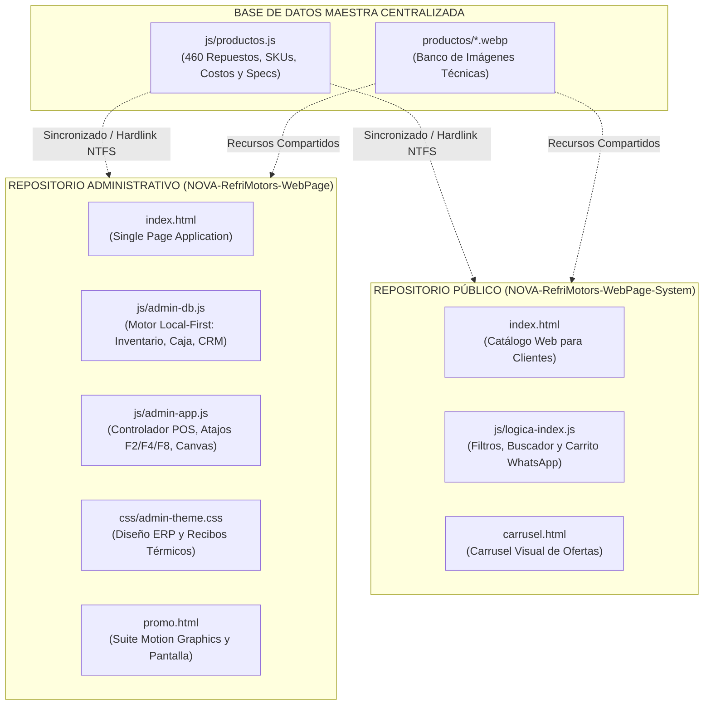
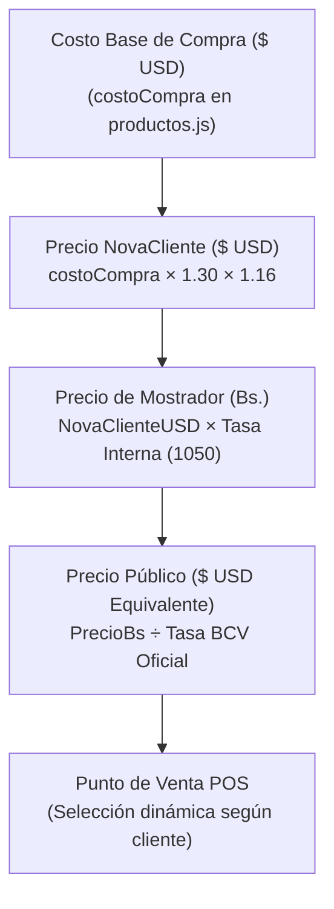
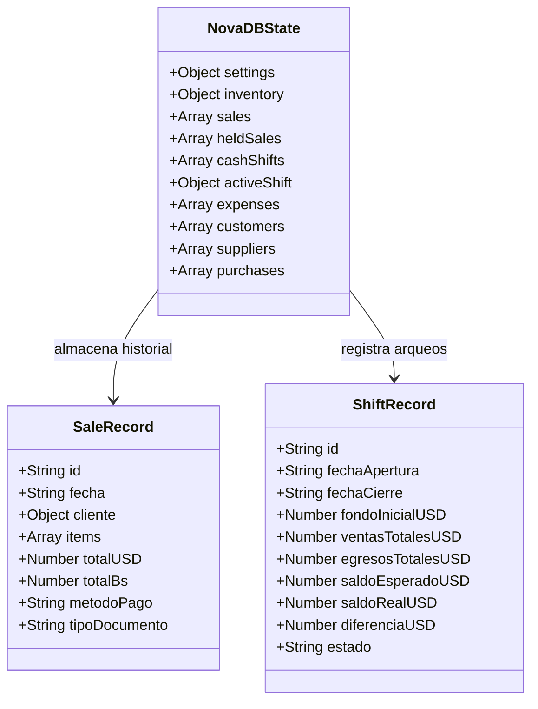

# ARQUITECTURA DE SOFTWARE Y ESTRUCTURA DE ARCHIVOS

**Proyecto:** NOVA RefriMotors - Plataforma Tecnológica Dual  
**Organización:** NOVA RefriMotors (RIF: J-504401994, Cabimas, Venezuela)  
**Documento Técnico:** Manual de Arquitectura, Componentes y Directorio de Archivos  
**Fecha:** Noviembre 2026  

---

## 1. VISIÓN GENERAL DE LA ARQUITECTURA DUAL

El ecosistema digital de **NOVA RefriMotors** está estructurado bajo una **arquitectura desacoplada de dos aplicaciones especializadas**, compartiendo una base de datos maestra centralizada de 460 repuestos y especificaciones técnicas:



### Funciones Específicas de Cada Repositorio:
1. **`NOVA-RefriMotors-WebPage` (Sistema Administrativo Interno - ERP / POS)**:
   - Uso exclusivo para personal en mostrador, cajeros, administradores y almacén.
   - Operaciones de cobro rápido, inventario dinámico, control de caja/turnos, egresos, compras y generación de tickets térmicos con Canvas 2D.
   - **Local-First**: Persistencia directa en navegador, operando al 100% incluso ante caídas de internet.
2. **`NOVA-RefriMotors-WebPage-System` (Catálogo Digital para Clientes)**:
   - Uso público orientado al comprador final y talleres desde sus celulares o computadoras.
   - Permite explorar el catálogo por categorías, ver fichas técnicas, calcular precios al BCV y enviar pedidos directamente al WhatsApp oficial de NOVA RefriMotors.
   - Mantiene la vitrina visual `carrusel.html` para exhibir ofertas a los clientes.

---

## 2. MAPA COMPLETO DE ARCHIVOS Y CARPETAS

A continuación se detalla la función precisa de cada archivo y carpeta existente en el repositorio administrativo `NOVA-RefriMotors-WebPage`:

### 2.1. Raíz del Proyecto
| Archivo / Carpeta | Tipo | Propósito y Funcionamiento |
| :--- | :--- | :--- |
| **`index.html`** | Archivo HTML | **Página principal del Sistema Administrativo (ERP)**. Implementa la interfaz Single Page Application (SPA) con menú lateral desplegable, barra superior con reloj en vivo, widget de Tasa BCV y los 7 paneles operativos (POS, Caja, Inventario, Compras, Clientes, Marketing y Ajustes). |
| **`promo.html`** | Archivo HTML | **Suite de Promociones y Motion Graphics**. Pantalla de exhibición visual para monitores en sala de espera o tienda, mostrando animaciones de repuestos y ofertas destacadas. |
| **`jsconfig.json`** | Configuración | **Configuración de lenguaje JavaScript**. Define `"module": "none"` y restringe el análisis semántico para evitar que VS Code inyecte sentencias `import` automáticas que causaban rotura de sintaxis. |
| **`.gitignore`** | Configuración Git | Define archivos y carpetas que no deben subirse al repositorio de control de versiones (archivos temporales, logs, etc.). |
| **`.gitattributes`** | Configuración Git | Reglas de normalización de saltos de línea (CRLF/LF) y codificación de texto UTF-8 para archivos del proyecto. |
| **`.vscode/`** | Directorio | Contiene [settings.json](file:///c:/Users/ELITEDESK/Desktop/vs%20code%20web%20projects/github/NOVA-RefriMotors-WebPage/.vscode/settings.json) con ajustes obligatorios para deshabilitar las auto-importaciones de JavaScript en el editor. |
| **`assets/`** | Directorio | Archivos gráficos institucionales, logotipos de marcas representadas e iconografía corporativa. |
| **`css/`** | Directorio | Hojas de estilo en cascada del sistema administrativo y componentes modulares. |
| **`design/`** | Directorio | Especificaciones de diseño [DESIGN.md](file:///c:/Users/ELITEDESK/Desktop/vs%20code%20web%20projects/github/NOVA-RefriMotors-WebPage/design/DESIGN.md) con paleta de colores y lineamientos de marca. |
| **`docs/`** | Directorio | Documentación ejecutiva y técnica del sistema para directivos y desarrolladores. |
| **`js/`** | Directorio | Scripts y motores lógicos en JavaScript (Persistencia, Controlador POS, Catálogo). |
| **`productos/`** | Directorio | Repositorio de más de 350 imágenes técnicas de repuestos en formato comprimido WebP. |

---

### 2.2. Directorio `js/` (Motores Lógicos y Datos)
| Archivo | Rol en el Sistema |
| :--- | :--- |
| **[admin-db.js](file:///c:/Users/ELITEDESK/Desktop/vs%20code%20web%20projects/github/NOVA-RefriMotors-WebPage/js/admin-db.js)** | **Motor de Datos Local-First (Base de Datos Local)**.<br>• Gestiona el almacenamiento reactivo en `localStorage`.<br>• Controla existencias dinámicas de inventario.<br>• Registra ventas, cortes de caja X/Z, egresos y turnos activos.<br>• Mantiene el directorio de clientes (CRM) y proveedores.<br>• Permite generar y restaurar copias de seguridad completas en formato JSON. |
| **[admin-app.js](file:///c:/Users/ELITEDESK/Desktop/vs%20code%20web%20projects/github/NOVA-RefriMotors-WebPage/js/admin-app.js)** | **Controlador de la Aplicación y Punto de Venta (POS)**.<br>• Enrutador SPA (navegación entre los 7 módulos sin recarga).<br>• Manejador de atajos de teclado (`F2` buscar, `F4` cobrar, `F8` pausar ticket).<br>• Lógica del carrito de mostrador y cálculo de totales en USD/Bs.<br>• **Generador de Tickets en Canvas 2D**: Dibuja el recibo térmico con tipografía nítida, datos fiscales (RIF J-504401994), desglose de ítems y código QR. |
| **[productos.js](file:///c:/Users/ELITEDESK/Desktop/vs%20code%20web%20projects/github/NOVA-RefriMotors-WebPage/js/productos.js)** | **Base de Datos Maestra de Productos (460 Repuestos)**.<br>Contiene el arreglo `products` con el catálogo oficial: SKUs (`GAS002`, `CAP001`, `FIL143`), nombres técnicos, categorías (Refrigeración, Electricidad, Herramientas, etc.), costo de compra base (`costoCompra`), rutas de imágenes y especificaciones técnicas detalladas. |
| **[factura-canvas.js](file:///c:/Users/ELITEDESK/Desktop/vs%20code%20web%20projects/github/NOVA-RefriMotors-WebPage/js/factura-canvas.js)** | Módulo auxiliar de apoyo para renderizado avanzado de comprobantes y cotizaciones en Canvas. |
| **[logica-index.js](file:///c:/Users/ELITEDESK/Desktop/vs%20code%20web%20projects/github/NOVA-RefriMotors-WebPage/js/logica-index.js)** | Biblioteca común de utilidades de conversión de divisas, cálculo de precios y filtrado técnico. |

---

### 2.3. Directorio `css/` (Estilos Visuales)
| Archivo | Rol en el Sistema |
| :--- | :--- |
| **[admin-theme.css](file:///c:/Users/ELITEDESK/Desktop/vs%20code%20web%20projects/github/NOVA-RefriMotors-WebPage/css/admin-theme.css)** | **Estilo Corporativo del Sistema ERP**.<br>Define la estructura de diseño moderna tipo tablero empresarial: Barra lateral (Sidebar), barra superior de métricas, reloj, tarjetas KPI, rejilla de productos POS, panel de ticket de mostrador, tablas de inventario y caja, modales flotantes y reglas `@media print` para impresoras térmicas. |
| **[base.css](file:///c:/Users/ELITEDESK/Desktop/vs%20code%20web%20projects/github/NOVA-RefriMotors-WebPage/css/base.css)** | Variables globales CSS (`--primary`, `--bg-dark`, `--font-sans`), resets de márgenes y tipografías base. |
| **[alertas.css](file:///c:/Users/ELITEDESK/Desktop/vs%20code%20web%20projects/github/NOVA-RefriMotors-WebPage/css/alertas.css)** | Estilos para ventanas modales de avisos del sistema (éxito, advertencia, confirmación). |
| **[factura.css](file:///c:/Users/ELITEDESK/Desktop/vs%20code%20web%20projects/github/NOVA-RefriMotors-WebPage/css/factura.css)** | Estilos de maquetación para facturas impresas y notas de entrega tradicionales. |
| **[carrito.css](file:///c:/Users/ELITEDESK/Desktop/vs%20code%20web%20projects/github/NOVA-RefriMotors-WebPage/css/carrito.css)** | Estilos de listas de ítems seleccionados y controles de cantidad. |
| **[catalogo.css](file:///c:/Users/ELITEDESK/Desktop/vs%20code%20web%20projects/github/NOVA-RefriMotors-WebPage/css/catalogo.css)** | Tarjetas y cuadrícula de visualización de productos. |
| **[quickview.css](file:///c:/Users/ELITEDESK/Desktop/vs%20code%20web%20projects/github/NOVA-RefriMotors-WebPage/css/quickview.css)** | Vista previa rápida modal de especificaciones de repuestos. |

---

### 2.4. Directorio `assets/` (Recursos Gráficos)
- **Identidad Corporativa**:
  - `nova-logo-color.png`: Logotipo oficial a color de NOVA RefriMotors.
  - `nova-factura.png`: Encabezado membretado para comprobantes y recibos.
  - `nova_favicon.png`: Ícono oficial de pestaña del navegador.
  - `nova_refrimotors_banner.png`: Banner institucional para cabeceras y pantallas.
  - `nova_footer2.png`: Pie de página gráfico con información de contacto.
- **Marcas de Fabricantes Representadas**:
  - `oster-logo.png` (Oster)
  - `steinmann-logo.png` (Steinmann)
  - `ingco-logo.png` (INGCO Tools)
  - `Log_Exceline.png` (Exceline Protectores Electrónicos)
  - `maxwell-gold-logo.png` (Maxwell Gold Capacitores)
  - `paragon-logo-negro.png` (Paragon Timers y Relojes de Descongelación)
  - `productos66-logo.png` (Línea de Químicos y Selladores)
  - `whatsapp-icono.png` (Ícono oficial de WhatsApp para contacto)

---

## 3. LÓGICA DE NEGOCIO Y CÁLCULO MULTIMONEDA VENEZOLANO

El sistema opera con la lógica matemática y cambiaria real de mostrador implementada en [admin-db.js](file:///c:/Users/ELITEDESK/Desktop/vs%20code%20web%20projects/github/NOVA-RefriMotors-WebPage/js/admin-db.js) y [admin-app.js](file:///c:/Users/ELITEDESK/Desktop/vs%20code%20web%20projects/github/NOVA-RefriMotors-WebPage/js/admin-app.js):



### Fórmulas del Sistema:
1. **Precio Aliado / NovaCliente (\$ USD)**:
   $$\text{Precio NovaCliente USD} = \text{costoCompra} \times 1.30 \times 1.16$$
   *(Garantiza un 30% de margen base de reposición más un 16% de utilidad de taller)*.

2. **Precio Público en Bolívares (Bs.)**:
   $$\text{Precio Mostrador Bs.} = \text{Precio NovaCliente USD} \times \text{Tasa Interna (1050)}$$

3. **Precio Público en Dólares (\$ USD)**:
   $$\text{Precio Público USD} = \frac{\text{Precio Mostrador Bs.}}{\text{Tasa Oficial BCV}}$$

*Al cambiar en tiempo real la Tasa BCV o la Tasa Interna desde el panel superior, todos los precios del catálogo se recalculan al instante sin necesidad de modificar el código fuente.*

---

## 4. ESQUEMA DE DATOS LOCAL-FIRST (`localStorage`)

Para asegurar continuidad operativa ante cortes eléctricos o de internet, el motor `NovaDB` persiste todas las transacciones bajo claves estructuradas en el navegador:



- Clave `nova_erp_settings`: Configuración general de tasas y datos fiscales de la empresa.
- Clave `nova_erp_inventory`: Diccionario de existencias `{ SKU: cantidad }` para los 460 productos.
- Clave `nova_erp_sales`: Arreglo histórico de todas las facturas y ventas cerradas.
- Clave `nova_erp_held_sales`: Ventas puestas en pausa para atención simultánea en mostrador.
- Clave `nova_erp_cash_shifts`: Registro de aperturas, cierres de turno y arqueos de caja (cortes X y Z).
- Clave `nova_erp_expenses`: Salidas de dinero por gastos operativos menores.
- Clave `nova_erp_customers`: Directorio CRM de talleres, mecánicos y clientes particulares.
- Clave `nova_erp_suppliers`: Directorio de empresas distribuidoras mayoristas.
- Clave `nova_erp_purchases`: Registro de compras y entradas de mercancía al almacén.

---

## 5. PROCEDIMIENTO DE SINCRONIZACIÓN Y MANTENIMIENTO

Para mantener sincronizada la lista de repuestos y las imágenes entre el sistema administrativo y el catálogo público de clientes, se utiliza un enlace duro (*hardlink*) del sistema de archivos NTFS en Windows:

```powershell
# Enlace NTFS para sincronizar productos.js sin duplicar archivos:
New-Item -ItemType HardLink -Path ".\NOVA-RefriMotors-WebPage\js\productos.js" -Target ".\NOVA-RefriMotors-WebPage-System\js\productos.js" -Force
```

Cualquier nuevo repuesto agregado a `productos.js` quedará disponible de inmediato tanto en el Punto de Venta administrativo como en el catálogo web público de compras.

